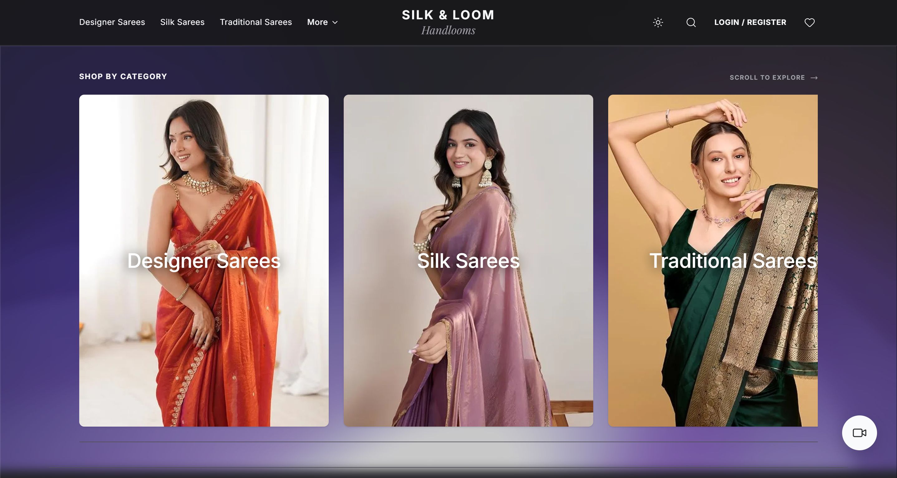
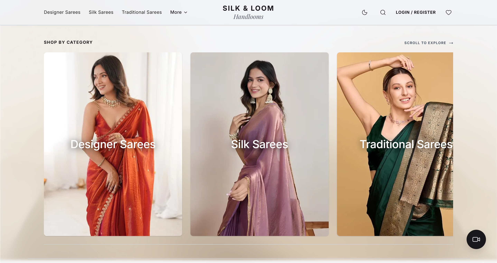
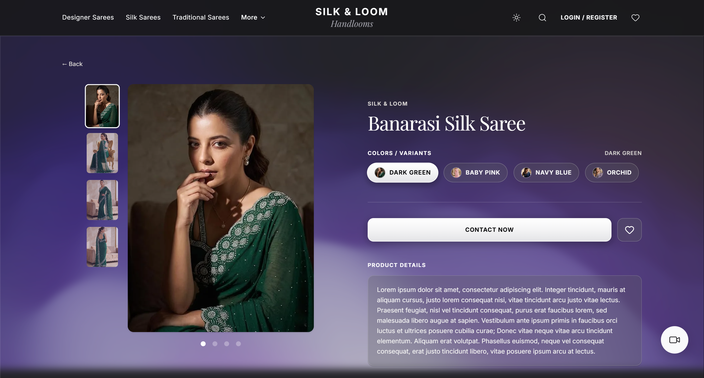
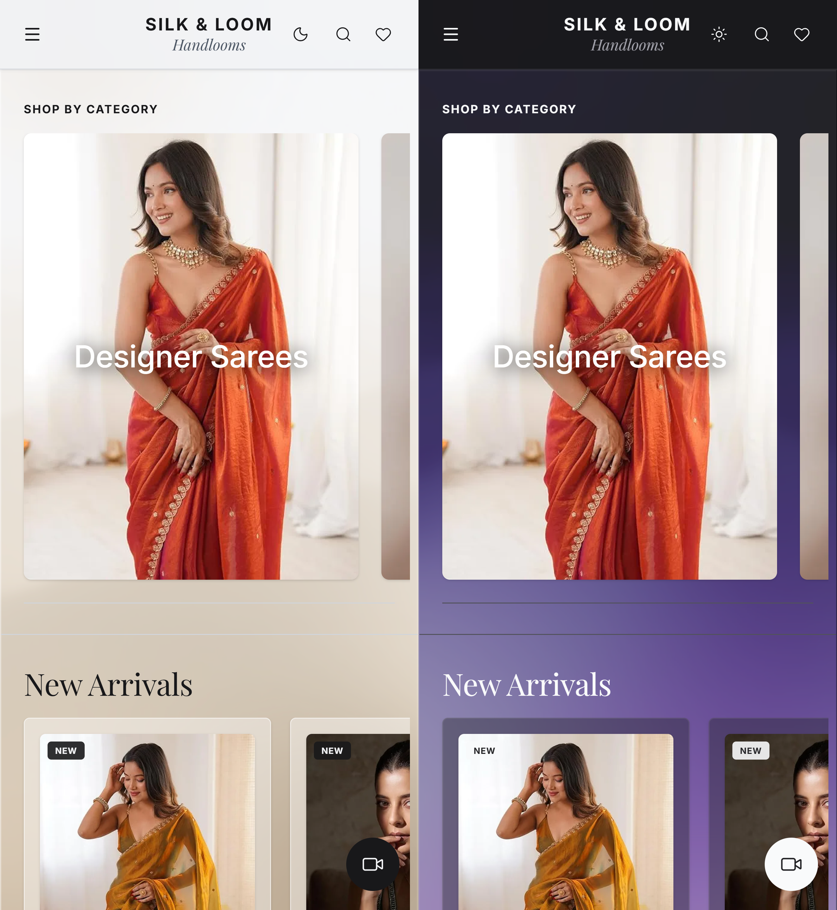

# 🥻 Silk & Loom: Luxury Saree Boutique Frontend

> A responsive, high-performance e-commerce frontend for handcrafted Indian sarees, built with **React 19**, **TypeScript**, **Tailwind CSS v4**, **WebGL shaders (OGL / Three.js)**, and **Framer Motion**.
>
> _Silk & Loom is a fictional demo brand created for portfolio purposes._

[](https://react.dev/)
[](https://www.typescriptlang.org/)
[](https://vitejs.dev/)
[](https://tailwindcss.com/)
[](https://threejs.org/)
[](LICENSE)

---

## 📸 Screenshots

| Home (Dark) | Home (Light) |
| :---: | :---: |
|  |  |

| Product Details | Mobile View |
| :---: | :---: |
|  |  |

---

## 🌐 Live Demo

- **🛍️ Storefront:** [https://silk-and-loom.vercel.app](https://silk-and-loom.vercel.app)
- **⚙️ Backend API and Admin Demo:** [saree-store-backend](https://github.com/s-akhil-08/saree-store-backend) (read-only demo admin credentials are in that repo's README)

> [!IMPORTANT]
> Registration sends a **real OTP email**, so please use an email address you own. All products and demo data are fictional.

---

## ✨ Features

### 🎨 Editorial Luxury UI
- Serif display headings paired with clean sans-serif body text, glassmorphism cards, and balanced spacing
- **Ambient WebGL shader background** (GPU-accelerated wave effect with `ogl` and `three.js`)
- **Dark and light mode** with smooth transitions and persistent preference
- Page transitions and micro-interactions with `framer-motion`

### 🔍 Product Discovery
- **Live search and category filtering** across fabrics and weaves (Gadwal Silk, Gajji Silk, Modal Silk, Cotton Silk, Organza)
- **Colour variant switcher** with synchronized image galleries
- **Pinch-to-zoom viewer:** fullscreen pan, drag, and zoom with `react-zoom-pan-pinch`
- **Draggable saree rails** for collections and new arrivals (mouse wheel and touch)

### 🔐 Authentication and OTP
- Registration with 4-digit **email OTP verification**
- Forgot-password flow with OTP and new password creation
- JWT-based sessions with automatic token refresh and header injection
- Profile updates (name, mobile, email) confirmed by OTP

### 📅 Virtual Styling Consultations
- Date picker and time-slot selector for one-on-one video draping sessions
- Consultation dashboard with status badges: `Confirmed`, `Completed`, `Pending`, `Rescheduled`, `Cancelled`

### 💬 WhatsApp Inquiries
- "Contact Now" button on each product that logs the lead and opens WhatsApp with the product details pre-filled (no cart or checkout needed)

### ⚡ Resilient Dual-Backend Routing
- **Primary backend (Render):** product catalog, categories, new arrivals, and user profiles
- **Secondary backend (Vercel serverless):** OTP verification, email, and consultation bookings
- **In-memory caching and silent pre-warming** to reduce cold-start delays

---

## 🛠 Tech Stack

| Domain | Technology | Purpose |
| :--- | :--- | :--- |
| Framework | **React 19** and **TypeScript** | Component-driven UI with strict typing |
| Build tool | **Vite 8** | Fast HMR and optimized bundling |
| Styling | **Tailwind CSS v4** | Utility-first styling |
| Animation | **Framer Motion** | Layout transitions and modals |
| Graphics | **Three.js** and **OGL** | WebGL ambient shaders |
| Icons | **Lucide React** | Vector icons |
| Routing | **React Router v7** | Client-side routing with Suspense skeletons |
| Image zoom | **react-zoom-pan-pinch** | Multi-touch zoom |

---

## 🚀 Getting Started

### Prerequisites
- **Node.js** v18 or higher
- **npm** (or pnpm / yarn)

### Installation

```bash
# 1. Clone
git clone https://github.com/s-akhil-08/saree-store-frontend.git
cd saree-store-frontend

# 2. Install dependencies
npm install

# 3. Configure environment
cp .env.example .env

# 4. Start the dev server
npm run dev
```

Open [http://localhost:5173](http://localhost:5173).

### Environment Variables

```env
# Replace these with your own backend URLs if you deploy the backend yourself
VITE_PRIMARY_API_URL=https://your-backend-name.onrender.com
VITE_SECONDARY_API_URL=https://your-backend-name.vercel.app
```

### Other Commands

```bash
npm run build      # production build
npm run preview    # preview the production build
```

---

## 📁 Project Structure

```text
saree-store-demo/
├── public/                  # Favicons, manifest, robots.txt
├── src/
│   ├── components/
│   │   ├── AmbientBackground    # WebGL wave shader
│   │   ├── CategoryTile         # Category cards
│   │   ├── Header / Footer      # Navigation, search, theme switcher
│   │   ├── ProductCard          # Product card with variant previews
│   │   ├── Skeletons            # Route-specific loading skeletons
│   │   └── VideoConsultation    # Booking modal with date/time picker
│   ├── context/
│   │   ├── AuthContext          # Auth and token management
│   │   ├── ThemeContext         # Dark/light mode
│   │   ├── ToastContext         # Toast notifications
│   │   └── WishlistContext      # Wishlist state
│   ├── pages/
│   │   ├── Home                 # Hero, categories, new arrivals
│   │   ├── Products             # Filterable catalog with pagination
│   │   ├── ProductDetails       # Zoom gallery, variants, contact CTA
│   │   ├── Profile              # User info, consultations, OTP forms
│   │   ├── Login / Signup       # Login and registration
│   │   └── OtpVerification      # Email OTP verification
│   ├── api.ts                   # API client with dual-backend routing
│   └── App.tsx                  # Routes with Suspense fallbacks
├── .env.example
├── .gitignore
└── vite.config.ts               # Vite, compression, image optimizer
```

---

## 💡 Design Decisions

- **Dual-backend routing with pre-warming** keeps the free-tier hosting usable by hiding cold starts behind caching and background wake-up requests.
- **Route-level code splitting and skeletons** keep the first load light, since the WebGL and animation libraries are heavy.
- **WhatsApp inquiries instead of checkout** match how small boutiques actually sell, while still capturing every lead.

---


## 📄 License

Licensed under the [MIT License](LICENSE).
